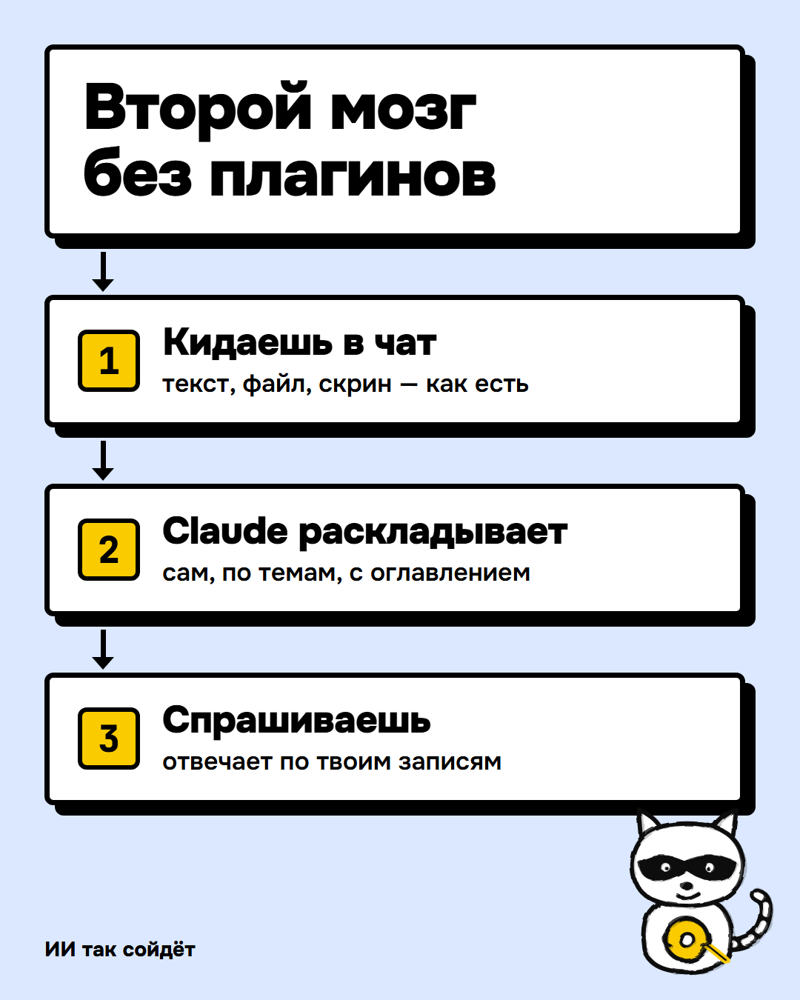
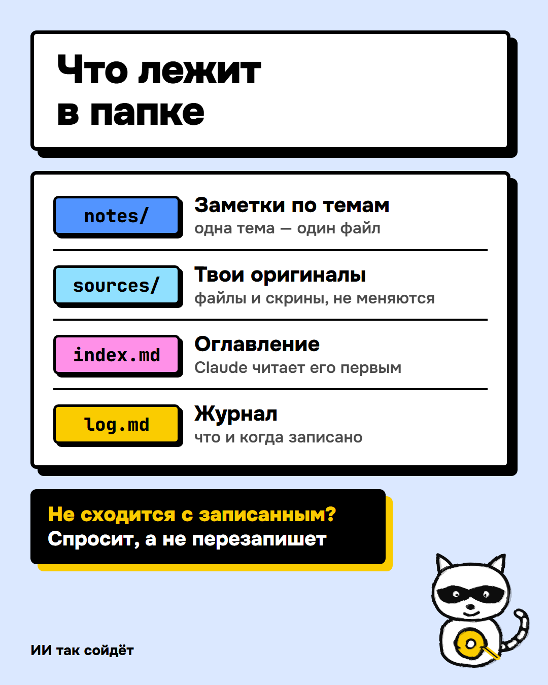

# База знаний, которая ведёт себя сама

**Без графов, векторных баз и 47 плагинов.** Одна папка с текстовыми файлами и короткий файл правил. Кидаешь в чат текст, файл или скрин — агент сам раскладывает по темам, ведёт оглавление и отвечает по твоим записям.

Как бумажный ежедневник с разделами: нужное дописывается в свой раздел, устаревшее зачёркивается. Только пишешь не ты.

<p align="center"></p>

## Старт одним сообщением

1. Создай пустую папку, например `Документы\База`.
2. Открой её в агенте: приложение Claude → вкладка **Code** → выбрать папку. Терминал не нужен.
3. Вставь сообщение:

```
Скачай шаблон https://github.com/AIsoidet/claude-vault-starter (архив main.zip) и распакуй его содержимое прямо в эту папку, без вложенной папки. Потом прочитай AGENTS.md и настрой базу под меня.
```

Агент скачает шаблон, задаст 3 вопроса о тебе и перепишет блок «Обо мне». Пример аналитика предложит оставить или убрать.

<p align="center"></p>

## Не только Claude

Правила лежат в `AGENTS.md` — общем формате, который читают разные агенты. Подойдёт любой, который работает с папкой на компьютере:

| Агент | Где взять |
|---|---|
| Claude Code | приложение Claude, вкладка Code (подписка Pro и выше) |
| Codex | от OpenAI, входит в подписку ChatGPT |
| Cursor | редактор с агентом |
| Gemini CLI | от Google, файл `GEMINI.md` уже ссылается на правила |

**Обычный чат ChatGPT, Claude или Gemini не подойдёт:** он не может сам записывать файлы, раскладывать придётся руками. Команды `/inbox` и `/lint` и встроенный откат `/rewind` есть только в Claude Code. В других агентах говори словами: «разбери inbox», «проверь базу».

## Первые 10 минут: пример дата-аналитика

В шаблоне лежит пример вымышленного аналитика: заметки с определениями метрик, выгрузка заказов и две сырые заметки в `inbox/`.

1. Напиши **«разбери inbox»** (в Claude Code — `/inbox`). Агент:
   - разложит созвон и сообщение из слака по заметкам, задачи и сроки — в `notes/задачи.md`;
   - **поймает противоречие**: маркетинг считает активным того, кто открыл приложение, а в базе записано другое определение. Не перезапишет, спросит тебя.
2. Спроси: **«сколько выручки с рекламы в октябре?»**
   Наивный подсчёт по выгрузке даёт 42 заказа на 185 220 ₽, так же считает рекламный кабинет.
   Агент прочитает заметку про таблицу заказов, уберёт тестовые заказы, отмены и возвраты: **25 заказов, 103 060 ₽**, со ссылкой на заметку с правилами.
3. Скажи «запиши, почему цифры кабинета и наши расходятся». В следующий раз объяснять не придётся.

Ради этого всё и делается: определения, ловушки и решения записаны один раз, а агент использует их в каждом ответе.

## Как пользоваться каждый день

| Что делаешь | Что говоришь |
|---|---|
| Узнал, созвонился, скопировал из чата | вставь текст в чат: «запиши» или просто сам текст |
| Есть файл (CSV, PDF, скрин) | дай путь: «вот выгрузка D:\Downloads\orders.csv». Копия ляжет в `sources/`, суть в `notes/`, твой файл не тронется |
| Нужен ответ | обычный вопрос: «как мы считаем retention?», «что я решил по отпуску?» |
| Ничего | раз в неделю агент сам проверит базу и скажет одной строкой, что нашёл |
| Агент что-то испортил | в Claude Code двойной `Esc` или `/rewind` |

**Один чат на одну задачу.** Чаты друг друга не помнят, и так задумано: память живёт в файлах. Новый чат первым читает оглавление, поэтому с базой можно работать хоть из десяти чатов.

**Вопросы о разрешениях.** В Claude Code шаблон включает режим, где правки внутри папки идут без вопросов (`.claude/settings.json`). Прочитать файл вне папки, например из «Загрузок», агент один раз попросит разрешения — это нормально.

## Почему устроено именно так

Каждое правило взято из реальной ошибки в живой базе на 1 600 заметок:

| Что сломалось | Что в шаблоне |
|---|---|
| Один факт хранился в трёх местах, копии разошлись, верную не найти | **У факта один дом.** В остальных местах ссылка |
| Файл правил раздулся до 92 КБ, каждый чат начинался с 23 тыс. токенов | В правилах только правила, факты в `notes/`, еженедельная проверка следит за размером |
| Выгрузка чатов на 150 тыс. токенов всплывала в поиске и съедала контекст | Большое лежит в `sources/`, скрытом от поиска (файл `.ignore`) |
| Резервное копирование «для защиты» никто не запускал 5 недель | Страховка без дисциплины: встроенный откат и правило «ничего не удаляет» |
| Векторный поиск: на русском промахивался, на CPU индексировал часами | **Векторный поиск не нужен**, пока заметок меньше нескольких тысяч. Хватает оглавления |
| Агент «уверенно» перезаписывал старые выводы | Противоречие выносится тебе, а не исправляется молча |
| Ручную проверку базы никто не делал | Проверка раз в неделю запускается сама |

## Страховка

Без настройки:
- **Откат.** Claude Code запоминает свои правки: двойной `Esc` или `/rewind` — и файлы как были до выбранного сообщения. Откатываются только правки агента, точки хранятся около месяца.
- **Ничего не удаляется.** Устаревшее и разобранное агент переносит в `archive/`, удаляет только по прямой просьбе.

По желанию:
- **Облако.** Папка в OneDrive, Google Drive, iCloud или Dropbox — у каждого файла история версий и копия не только на твоём диске.
- **Git.** `git init` в папке — и хук в `.claude/settings.json` сам коммитит после каждого ответа. Без git хук молча ничего не делает.

## Под себя

- «Обо мне» агент перепишет сам при первом запуске. Сказать позже: «настрой базу под меня».
- Нужен свой раздел (`projects/`, `people/`, `рецепты/`) — скажи «заведи раздел для …», агент добавит его в правила.
- **Obsidian** по желанию, чтобы читать базу: открой папку как vault, плагины не нужны. Для статей из браузера — [Obsidian Web Clipper](https://obsidian.md/clipper) с папкой `inbox`.
- **Из других проектов:** в глобальный `~/.claude/CLAUDE.md` добавь строку «Моя база знаний: `D:\База`. Когда нужен контекст обо мне или прошлых решениях, читай `index.md` и нужные заметки. Из других проектов только читай.»

## Где этого мало

- **Команда, где пишут одновременно** — нужен общий репозиторий с git, а не папка.
- **Тысячи заметок** — тогда стоит подумать о поиске по смыслу. Сначала проверь на своих запросах, что он находит больше, чем оглавление.
- **Секреты** (пароли, ключи, паспорт) сюда не клади: файлы читает модель.
